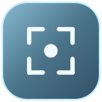
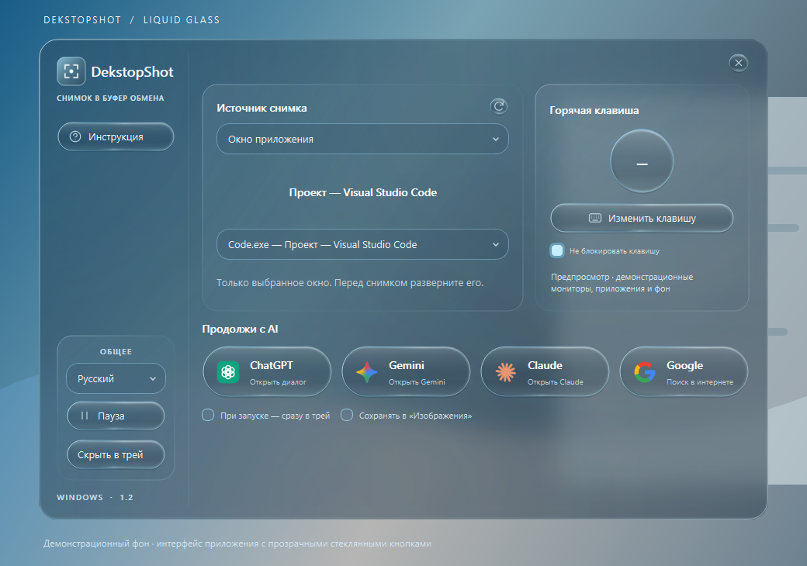

<p align="center">
  
</p>

<h1 align="center">DekstopShot — скриншоты для Windows</h1>

<p align="center">
  Выберите монитор или окно. Нажмите клавишу. Вставьте снимок через Ctrl + V.<br>
  Windows screenshot tool · clipboard · global hotkey · Liquid Glass
</p>

<p align="center">
  
  
  <a href="LICENSE"></a>
  <a href="https://github.com/fobesyka-beep/DekstopShot/actions/workflows/windows-build.yml"></a>
</p>

<p align="center">
  <a href="https://github.com/fobesyka-beep/DekstopShot/releases/latest">Скачать для Windows</a> ·
  <a href="docs/USAGE.md">Инструкция</a> ·
  <a href="VALIDATION.md">Проверки</a> ·
  <a href="https://github.com/fobesyka-beep/DekstopShot/issues">Сообщить об ошибке</a>
</p>

**DekstopShot 1.2** — приложение на Python и PySide6 для захвата экрана или конкретного окна в системный буфер обмена Windows. Работает в трее, поддерживает глобальную горячую клавишу, несколько мониторов и разные масштабы DPI. Интерфейс в стиле Liquid Glass доступен **на русском и английском языках**. По желанию снимки также сохраняются в PNG в подпапке **DekstopShot** системной папки **«Изображения»**.

English overview: capture a selected monitor or application window straight to the Windows clipboard. Version 1.2 adds optional PNG saving to Pictures/DekstopShot and a cleaner interface. Russian/English UI, startup update checks and shared hotkeys remain available. Saving to files is off by default.



*Предпросмотр реальных виджетов Qt на демонстрационном фоне. Изображение не подтверждает внешний вид системного Acrylic на каждом компьютере.*

## Возможности

| Функция | Как работает |
| --- | --- |
| Скриншот монитора | Выбранный экран закрепляется по идентификатору устройства; поддерживаются отрицательные координаты и разный DPI. |
| Скриншот окна | Захватывается одно выбранное открытое окно через Windows Graphics Capture, даже если его перекрывает другое. |
| Глобальная клавиша | По умолчанию обычный **минус над буквами**. Можно назначить другую клавишу или сочетание с Ctrl, Alt и Shift. |
| Обычный ввод клавиши | Опция **«Не блокировать клавишу»** передаёт нажатие активному приложению и включена по умолчанию. Её можно отключить для эксклюзивной горячей клавиши. |
| Русский и английский | При первом запуске язык определяется по Windows; выбранный вручную язык сохраняется. |
| Проверка обновлений | При запуске приложение проверяет последний стабильный GitHub Release и предлагает открыть его страницу, если версия новее. |
| Системный буфер | Снимок публикуется в DIB и PNG для вставки через **Ctrl + V**. |
| Сохранение в папку | Опция **Сохранять в «Изображения»** добавляет PNG в системную папку **Изображения\DekstopShot**; по умолчанию выключена. |
| Работа в фоне | Крестик скрывает настройки в трей. Пауза освобождает горячую клавишу для обычного ввода. |
| Быстрые ссылки | ChatGPT, Gemini, Claude и Google открываются в браузере; изображение пользователь вставляет вручную. |
| Стеклянный интерфейс | Компактное окно, прозрачные капсулы, голубая кромка и блики; при недоступном размытии есть читаемый запасной фон. |

Успешные снимки не показывают системные уведомления. **По умолчанию снимки попадают только в буфер**. Если включить сохранение, PNG также записываются в папку **Изображения\DekstopShot**. Отключение опции прекращает новые записи, ранее сохранённые файлы остаются. Приложение не отправляет снимки в сеть; синхронизацию системной папки через OneDrive и историю буфера отдельно контролирует Windows. Для проверки обновлений запрашиваются только публичные сведения о релизе на GitHub. API-ключи не нужны.

## Скачать и запустить

1. Откройте [последний релиз](https://github.com/fobesyka-beep/DekstopShot/releases/latest) и скачайте архив Windows x64 из раздела **Assets**.
2. Полностью распакуйте архив в обычную папку.
3. Запустите `DekstopShot.exe` из распакованной папки `DekstopShot`.
4. Выберите монитор или открытое окно приложения.
5. Нажмите **−**, затем **Ctrl + V** в нужном редакторе, чате или браузере.

**Для работы готовой сборки Python не нужен. Сохраняйте всю папку `DekstopShot`, включая `_internal`: один exe отдельно не запустится.** Установщика и цифровой подписи пока нет.

Целевая система — **Windows 10 22H2 / Windows 11 x64**. macOS и Linux для захвата сейчас не поддерживаются. Выбранное окно должно быть открыто и не свёрнуто; после его закрытия или перезапуска DekstopShot выберите его заново.

Начиная с версии 1.1 **«Не блокировать клавишу»** / **“Allow the key in other apps”** включено по умолчанию: минус запускает снимок и одновременно поступает в активную программу. Если отключить эту опцию, клавиша резервируется для DekstopShot. Пауза останавливает захват и освобождает обработчик клавиатуры. Можно назначить, например, **Ctrl + Alt + S**. Поведение защищённых окон, программ с повышенными правами и системных сочетаний зависит от Windows; работа во всех таких контекстах не гарантируется.

Пункт «При запуске — сразу в трей» не настраивает автозагрузку при входе в Windows.

## Сохранение, язык и обновления

Включите **Сохранять в «Изображения» / Save to Pictures**, чтобы вместе с копированием в буфер получать PNG в подпапке **DekstopShot** системной папки «Изображения». Учитывается расположение папки, заданное в Windows, в том числе перенаправление в OneDrive. Файлы получают уникальные имена; предыдущие снимки не перезаписываются. При ошибке записи уже скопированный снимок остаётся в буфере, а приложение сообщает о проблеме. Настройка сохраняется между запусками, по умолчанию выключена.

При первом запуске на русской Windows выбирается русский интерфейс, на остальных системах — английский. В боковой панели можно выбрать **Русский / English**; интерфейс меняется сразу, а выбор используется при следующих запусках. Настройки версий 1.0 и 1.1 продолжают загружаться; сохранение в папку автоматически не включается.

Проверка новой версии выполняется в фоне при старте. Если опубликован более новый стабильный релиз, в настройках появляется ссылка на его страницу. Программа не устанавливает обновление автоматически. Отсутствие интернета, лимит запросов GitHub или отсутствие релизов не мешают работе приложения.

Изменения выпуска: [DekstopShot 1.2.0](docs/releases/v1.2.0.md). История версий: [CHANGELOG.md](CHANGELOG.md).

Подробности о выборе источников, настройках и диагностике — в [инструкции](docs/USAGE.md).

## План развития

Выполнено в версии 1.1 и запланировано дальше:

- [x] Поддержка английского языка, определение языка системы при первом запуске и переключение **RU / EN**.
- [ ] Интеграция с **ProxyAPI** для обработки запросов к AI-сервисам из приложения.
- [ ] Автоматическая отправка полученного через ProxyAPI **ответа в Telegram**.

Сейчас кнопки AI-сервисов открывают сайты, а вставка снимка выполняется вручную. Автоматической отправки запросов или сообщений в Telegram в текущей версии нет.

## Запуск из исходников

Нужен Python **3.10–3.13 x64**; рекомендуется **3.12**. Команды PowerShell выполняются из корня проекта:

```powershell
git clone https://github.com/fobesyka-beep/DekstopShot.git
Set-Location DekstopShot
py -3.12 -m venv .venv
.\.venv\Scripts\python.exe -m pip install -r requirements.txt
.\.venv\Scripts\pythonw.exe main.py
```

Альтернатива — дважды запустить `Start_DekstopShot.cmd`: он подготовит окружение и запустит приложение без консоли.

## Разработка и сборка

- `main` — стабильная ветка и выпуски.
- `develop` — текущая разработка; изменения перед выпуском переносятся в `main`.

```powershell
.\.venv\Scripts\python.exe -m pip install -r requirements-build.txt
.\.venv\Scripts\python.exe -m ruff check .
.\.venv\Scripts\python.exe -m pytest -q
.\Build_EXE.cmd
```

Результат сборки: `dist\DekstopShot\DekstopShot.exe`. Для релиза упаковывается **вся папка `dist\DekstopShot`**, а не только exe. Windows workflow выполняет проверки и сборку в GitHub Actions.

Команды для публикации веток и Releases, а также настройки описания проекта для поиска находятся в [руководстве по публикации](docs/PUBLISHING.md).

## Статус проверок

Актуальные результаты автоматических проверок, сборки и реальных сценариев Windows приведены в [VALIDATION.md](VALIDATION.md). Наличие функции в исходниках не заменяет проверку на конкретной Windows-системе.

Визуальная проверка отсутствия жёлтой рамки пока не подтверждена: на поддерживаемых Windows приложение запрашивает `draw_border=False`, но измерительная проба не смогла наблюдать даже контрольный индикатор. На Windows 10 build 19045 API его отключения отсутствует. Границы проверок и оставшиеся ручные сценарии перечислены в [VALIDATION.md](VALIDATION.md).

## Лицензия

Исходный код распространяется по [MIT License](LICENSE). Лицензии и уведомления зависимостей — в [THIRD_PARTY_NOTICES.md](THIRD_PARTY_NOTICES.md).
